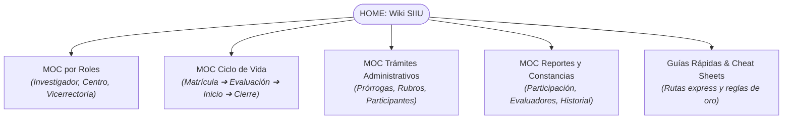

---
title: Base de Conocimiento y Wiki Operativa SIIU
description: Portal central de navegación, mapas de contenido, roles y procesos del Sistema de Información para la Investigación Universitaria (SIIU) - Universidad de Antioquia
tags:
  - portal
  - inicio
  - moc
  - siiu
  - udea
---

# Base de Conocimiento y Wiki Operativa del SIIU
### Sistema de Información para la Investigación Universitaria — Universidad de Antioquia

Bienvenido al centro de navegación y documentación interactiva del **Sistema de Información para la Investigación Universitaria (SIIU)**, administrado por la **Vicerrectoría de Investigación** y la **Vicerrectoría de Extensión** de la Universidad de Antioquia.

Esta Wiki sintetiza de forma didáctica, estructurada y modular los **31 procedimientos oficiales** (21 Guías operativas y 10 Instructivos técnicos) contenidos íntegramente en el [[Catalogo_Normativo_31_Docs|Archivo Maestro Fidedigno]].

---

## Mapas de Contenido (MOC - Maps of Content)

Para explorar la base de conocimiento según tus necesidades, selecciona una de las siguientes rutas de navegación:

---

## 🧭 Vías de Acceso Rápido

### 1. ¿Quién eres? (Navegación por Perfil)
- **[[Rol_Investigador|Investigador Principal / Tutor]]:** Matrícula de propuestas, cupos de Joven Investigador, solicitudes de prórroga, cambios de rubro y reporte de compromisos.
- **[[Rol_Centro_Investigacion|Centro de Investigación / Extensión]]:** Evaluación técnica formal, devolución para ajustes, aval institucional, aprobación de trámites y asignación de evaluadores.
- **[[Rol_Vicerrectoria|Vicerrectoría de Investigación]]:** Configuración de convocatorias, flujos de trámites, aval de instancias superiores (CODI) y aplicación definitiva de novedades.

### 2. ¿Qué necesitas hacer hoy? (Procesos Clave)
- **Inscribir un proyecto:** [[Matricula_Proyectos]] *(Convocatoria interna, Inscrito con financiación externa o Primer Proyecto)*.
- **Atender observaciones del Centro:** [[Evaluacion_y_Aval#subsanacion-y-ajustes-de-proyectos-devueltos|Subsanación de proyectos devueltos]].
- **Iniciar formalmente mi proyecto:** [[Inicio_Formal]] *(Pólizas, contratos, compromisos y centro de costos)*.
- **Solicitar más tiempo o recursos:** [[Modificaciones_y_Tramites]] *(Prórroga de inicio, prórroga de ejecución y cambio de rubro)*.
- **Gestionar Jóvenes Investigadores:** [[Programa_Joven_Investigador]] *(Matrícula de cupos, vinculación de hoja de vida y prórroga)*.
- **Finalizar y liquidar proyecto:** [[Cierre_y_Liquidacion]] *(Compromisos, acta de cierre y paz y salvo presupuestal)*.
- **Obtener certificados o constancias:** [[Reportes_y_Certificaciones]] *(Participación en proyectos, constancia de evaluador, historial)*.

### 3. Herramientas y Apoyo Operativo
- **[[CheatSheet_Investigador|Ficha Rápida del Investigador]]:** Pasos clave y rutas directas.
- **[[CheatSheet_Centro|Ficha Rápida para Centros]]:** Criterios de validación y control.
- **[[Reglas_Oro_SIIU|Reglas de Oro del SIIU]]:** Requisitos de adjuntos, ventanas emergentes, navegadores y limitaciones de cuentas bancarias.
- **[[Glosario_Terminos_SIIU|Glosario de Términos del SIIU]]:** Conceptos clave (*Solicitud vs Novedad*, estados de proyectos, rubros).
- **[[Catalogo_Normativo_31_Docs|Catálogo Normativo (31 Documentos)]]:** Índice con vínculos directos a las 21 Guías y 10 Instructivos del archivo maestro.

---

> [!TIP] CONSEJO DE NAVEGACIÓN EN OBSIDIAN
> Esta wiki utiliza enlaces nativos bidireccionales `[[Wikilinks]]`. Puedes abrir el **Graph View** (Vista de Grafo) de Obsidian para ver visualmente cómo se interconectan los roles, las convocatorias y las solicitudes administrativas.
