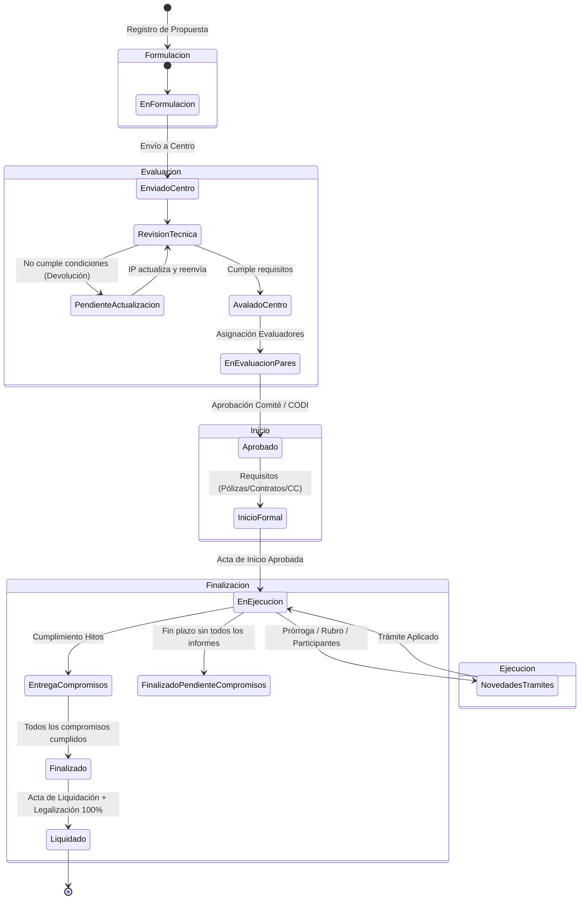

# Mapa de Contenido (MOC): Ciclo de Vida del Proyecto

El ciclo de vida de un proyecto en el **SIIU** es un proceso secuencial y gobernado por estados de control, desde la postulación en convocatoria o inscripción externa hasta el cierre presupuestal y académico.

---

## 阶段 1: Formulación y Matrícula

En esta fase, el Investigador Principal (IP) estructura la propuesta técnica, metodológica, financiera y el equipo de trabajo.

- **Convocatoria de Investigación Interna:** Proyectos postulados a convocatorias del CODI u otras dependencias.  
  Guía de referencia: [VI-GU-24](../../archivo_maestro/VI-GU-24.md) | Síntesis: [Matricula Proyectos](../02_PROCESOS_CLAVE/Matricula_Proyectos.md#convocatoria-interna)
- **Primer Proyecto de un Investigador:** Proceso especial que incluye el registro del perfil académico inicial en el sistema.  
  Guía de referencia: [VI-GU-17](../../archivo_maestro/VI-GU-17.md) | Síntesis: [Matricula Proyectos](../02_PROCESOS_CLAVE/Matricula_Proyectos.md#primer-proyecto)
- **Proyectos Inscritos con Financiación Externa:** Proyectos con aval de entes externos (Minciencias, Regalías, Cooperación Internacional, Empresas).  
  Guía de referencia: [VI-GU-18](../../archivo_maestro/VI-GU-18.md) | Síntesis: [Matricula Proyectos](../02_PROCESOS_CLAVE/Matricula_Proyectos.md#proyectos-inscritos)
- **Uso del Editor de Texto Enriquecido:** Directrices para tablas, fórmulas y formato libre de errores.  
  Guía de referencia: [VI-GU-25](../../archivo_maestro/VI-GU-25.md) | Síntesis: [Matricula Proyectos](../02_PROCESOS_CLAVE/Matricula_Proyectos.md#editor-ckeditor)
- **Información Complementaria Obligatoria:** ODS, Misión de Sabios, Agendas Regionales G8 y Caracterización Socioeconómica.  
  Guía de referencia: [VI-GU-16](../../archivo_maestro/VI-GU-16.md) | Síntesis: [Matricula Proyectos](../02_PROCESOS_CLAVE/Matricula_Proyectos.md#informacion-complementaria)

---

## 阶段 2: Evaluación, Aval y Ajustes

El proyecto enviado por el investigador entra al flujo de evaluación del Centro de Investigación y de la Vicerrectoría.

- **Evaluación Técnica Formal del Centro:** Verificación de condiciones habilitantes y requisitos de convocatoria.  
  Guía de referencia: [VI-GU-08](../../archivo_maestro/VI-GU-08.md) | Síntesis: [Evaluacion y Aval](../02_PROCESOS_CLAVE/Evaluacion_y_Aval.md#evaluacion-tecnica-de-centro)
- **Devolución de Proyecto para Ajustes (Solicitada por el Centro):** El Centro habilita secciones específicas y fija fecha límite.  
  Instructivo de referencia: [VI-IN-12](../../archivo_maestro/VI-IN-12.md) | Síntesis: [Evaluacion y Aval](../02_PROCESOS_CLAVE/Evaluacion_y_Aval.md#devolucion-para-ajustes)
- **Actualización por el Investigador del Proyecto Devuelto:** El IP corrige las secciones habilitadas y reenvía al Centro.  
  Instructivo de referencia: [VI-IN-05](../../archivo_maestro/VI-IN-05.md) | Síntesis: [Evaluacion y Aval](../02_PROCESOS_CLAVE/Evaluacion_y_Aval.md#subsanacion-y-ajustes-de-proyectos-devueltos)
- **Asignación de Evaluadores Pares:** Parametrización y asignación de pares ciegos o jurados.  
  Guía de referencia: [VI-GU-06](../../archivo_maestro/VI-GU-06.md) | Síntesis: [Evaluacion y Aval](../02_PROCESOS_CLAVE/Evaluacion_y_Aval.md#asignacion-evaluadores)

---

## 阶段 3: Inicio Formal del Proyecto

Una vez el proyecto está en estado **Aprobado**, no puede ejecutar recursos ni certificar horas docentes hasta su formalización.

- **Requisitos de Formalización:** Vinculación de pólizas contractuales, contratos de cofinanciación, convenios especiales y creación del Centro de Costos.
- **Acta de Inicio Formal:** Firma digital, registro de fechas oficiales de inicio y término, y paso a estado **En ejecución**.  
  Guía de referencia: [VI-GU-15](../../archivo_maestro/VI-GU-15.md) | Síntesis: [Inicio Formal](../02_PROCESOS_CLAVE/Inicio_Formal.md)

---

## 阶段 4: Ejecución y Gestión de Novedades

Durante el desarrollo de la investigación, surgen necesidades de ajuste operacional o presupuestal.

- **Diferencia Vital:**
  - *Solicitud Administrativa:* Aplica a proyectos internos con recursos UdeA / CODI.
  - *Novedad Administrativa:* Aplica a proyectos inscritos con financiación externa.
- **Prórrogas de Tiempo:**
  - Prórroga de Inicio (proyecto en estado *Aprobado*).
  - Prórroga de Ejecución (proyecto en estado *En ejecución*).  
  Guía de referencia: [VI-GU-23](../../archivo_maestro/VI-GU-23.md) | Síntesis: [Modificaciones y Tramites](../02_PROCESOS_CLAVE/Modificaciones_y_Tramites.md#prorroga-de-proyecto)
- **Modificaciones Presupuestales / Cambio de Rubro:** Creación de subrubros y traslados de saldos mayores a \$0.  
  Guía de referencia: [VI-GU-20](../../archivo_maestro/VI-GU-20.md) | Síntesis: [Modificaciones y Tramites](../02_PROCESOS_CLAVE/Modificaciones_y_Tramites.md#cambio-de-rubro)
- **Modificación del Equipo Humano:** Cambio de participantes e investigadores.  
  Guía de referencia: [VI-GU-19](../../archivo_maestro/VI-GU-19.md) | Síntesis: [Modificaciones y Tramites](../02_PROCESOS_CLAVE/Modificaciones_y_Tramites.md#cambio-de-participante)
- **Cambio de Responsable Institucional:**  
  Guía de referencia: [VI-GU-01](../../archivo_maestro/VI-GU-01.md) | Síntesis: [Modificaciones y Tramites](../02_PROCESOS_CLAVE/Modificaciones_y_Tramites.md#cambio-de-responsable)
- **Gestión y Plazo de Compromisos Académicos:**  
  Guías de referencia: [VI-GU-09](../../archivo_maestro/VI-GU-09.md) y [VI-GU-22](../../archivo_maestro/VI-GU-22.md) | Síntesis: [Gestion Compromisos](../02_PROCESOS_CLAVE/Gestion_Compromisos.md)

---

## 阶段 5: Cierre, Liquidación y Certificación

Fase final donde se rinden cuentas y se emite el paz y salvo definitivo.

- **Cierre Académico y Administrativo:** Aprobación del 100% de productos comprometidos (artículos, ponencias, tesis, patentes).
- **Cierre Financiero y Liquidación Presupuestal:** Legalización del 100% del presupuesto asignado y reintegro de remanentes si aplica.  
  Guía de referencia: [VI-GU-04](../../archivo_maestro/VI-GU-04.md) | Síntesis: [Cierre y Liquidacion](../02_PROCESOS_CLAVE/Cierre_y_Liquidacion.md)
- **Generación de Constancias y Certificados Oficiales:**  
  Instructivos: [VI-IN-01](../../archivo_maestro/VI-IN-01.md), [VI-IN-07](../../archivo_maestro/VI-IN-07.md), [VI-IN-08](../../archivo_maestro/VI-IN-08.md) | Síntesis: [Reportes y Certificaciones](../02_PROCESOS_CLAVE/Reportes_y_Certificaciones.md)
