---
title: Mapa de Contenido (MOC) - Navegación por Roles
description: Mapa interactivo de procesos, guías e instructivos clasificados por rol de usuario en el Sistema SIIU
tags:
  - moc
  - roles
  - siiu
---

# Mapa de Contenido (MOC): Navegación por Roles

En el **Sistema SIIU**, las acciones y permisos están segmentados según la responsabilidad administrativa y académica del usuario. Utiliza este mapa para localizar los procedimientos y guías pertinentes a tu perfil:

```mermaid
graph TD
    classDef inv fill:#e1f5fe,stroke:#0288d1,stroke-width:2px;
    classDef centro fill:#fff3e0,stroke:#f57c00,stroke-width:2px;
    classDef vice fill:#f3e5f5,stroke:#7b1fa2,stroke-width:2px;

    subgraph ROL_INV["Investigador Principal / Tutor"]
        direction TB
        I1["Matrícula de Propuestas"]:::inv
        I2["Ajuste de Proyecto Devuelto"]:::inv
        I3["Registro Hoja de Vida JI"]:::inv
        I4["Solicitud de Trámites (Prórrogas/Rubros)"]:::inv
        I5["Cumplimiento de Compromisos"]:::inv
        I6["Descarga de Constancias"]:::inv
    end

    subgraph ROL_CEN["Centro de Investigación / Extensión"]
        direction TB
        C1["Evaluación Técnica Formal"]:::centro
        C2["Solicitar Actualización al IP"]:::centro
        C3["Asignación de Evaluadores Pares"]:::centro
        C4["Aval de Proyectos"]:::centro
        C5["Aprobación de Trámites Administrativos"]:::centro
        C6["Gestión del Cierre del Proyecto"]:::centro
    end

    subgraph ROL_VIC["Vicerrectoría de Investigación"]
        direction TB
        V1["Configuración Convocatorias"]:::vice
        V2["Configuración Flujos de Trámites"]:::vice
        V3["Inicio Formal de Proyectos"]:::vice
        V4["Aval CODI / Aplicación Solicitudes"]:::vice
        V5["Aprobación Cupos Joven Investigador"]:::vice
        V6["Reportes Analíticos e Historial"]:::vice
    end
```

---

## 1. Investigador Principal / Tutor
*Responsable de formular proyectos, ejecutar presupuesto, coordinar talento y rendir cuentas académicas.*

| Operación | Guía / Instructivo Base | Procedimiento Sintetizado |
| :--- | :---: | :--- |
| **Inscripción en Convocatoria Interna** | [VI-GU-24](../../archivo_maestro/VI-GU-24.md) | [[Matricula_Proyectos#convocatoria-interna]] |
| **Matrícula de Primer Proyecto** | [VI-GU-17](../../archivo_maestro/VI-GU-17.md) | [[Matricula_Proyectos#primer-proyecto]] |
| **Matrícula de Proyecto Inscrito (Financiación Externa)** | [VI-GU-18](../../archivo_maestro/VI-GU-18.md) | [[Matricula_Proyectos#proyectos-inscritos]] |
| **Uso del Editor de Texto (CKEditor)** | [VI-GU-25](../../archivo_maestro/VI-GU-25.md) | [[Matricula_Proyectos#editor-ckeditor]] |
| **Actualizar Proyecto Devuelto por el Centro** | [VI-IN-05](../../archivo_maestro/VI-IN-05.md) | [[Evaluacion_y_Aval#subsanacion-y-ajustes-de-proyectos-devueltos]] |
| **Diligenciar Información Complementaria (ODS / Sabios / G8)** | [VI-GU-16](../../archivo_maestro/VI-GU-16.md) | [[Matricula_Proyectos#informacion-complementaria]] |
| **Matrícula de Cupo Joven Investigador** | [VI-GU-10](../../archivo_maestro/VI-GU-10.md) | [[Programa_Joven_Investigador#matricula-de-cupos]] |
| **Registro de Estudiante / Hoja de Vida JI** | [VI-IN-06](../../archivo_maestro/VI-IN-06.md) | [[Programa_Joven_Investigador#hoja-de-vida-estudiante]] |
| **Prórroga de Cupo Joven Investigador** | [VI-GU-11](../../archivo_maestro/VI-GU-11.md) | [[Programa_Joven_Investigador#prorroga-de-cupos]] |
| **Solicitud de Prórroga del Proyecto (Inicio o Ejecución)** | [VI-GU-23](../../archivo_maestro/VI-GU-23.md) | [[Modificaciones_y_Tramites#prorroga-de-proyecto]] |
| **Solicitud de Modificación Presupuestal / Cambio de Rubro** | [VI-GU-20](../../archivo_maestro/VI-GU-20.md) | [[Modificaciones_y_Tramites#cambio-de-rubro]] |
| **Solicitud de Cambio o Inclusión de Participantes** | [VI-GU-19](../../archivo_maestro/VI-GU-19.md) | [[Modificaciones_y_Tramites#cambio-de-participante]] |
| **Solicitud de Plazo para Entrega de Compromisos** | [VI-GU-22](../../archivo_maestro/VI-GU-22.md) | [[Gestion_Compromisos#solicitud-de-plazo]] |
| **Entrega y Subida de Compromisos Académicos** | [VI-GU-09](../../archivo_maestro/VI-GU-09.md) | [[Gestion_Compromisos#entrega-de-compromisos]] |
| **Generar Constancia Personal de Participación** | [VI-IN-07](../../archivo_maestro/VI-IN-07.md) | [[Reportes_y_Certificaciones#constancias-de-participacion]] |
| **Generar Constancia como Evaluador** | [VI-IN-08](../../archivo_maestro/VI-IN-08.md) | [[Reportes_y_Certificaciones#constancias-evaluador]] |
| **Consulta Histórica Personal de Proyectos** | [VI-IN-11](../../archivo_maestro/VI-IN-11.md) | [[Reportes_y_Certificaciones#reporte-por-persona]] |

Consulta la **[[Rol_Investigador|Guía Detallada del Investigador]]** y la **[[CheatSheet_Investigador|Ficha Rápida]]**.

---

## 2. Centro de Investigación / Extensión
*Unidad académico-administrativa de Facultad, Escuela o Instituto que valida la viabilidad técnica, avala y supervisa los proyectos.*

| Operación | Guía / Instructivo Base | Procedimiento Sintetizado |
| :--- | :---: | :--- |
| **Evaluación Técnica Formal y Aval del Proyecto** | [VI-GU-08](../../archivo_maestro/VI-GU-08.md) | [[Evaluacion_y_Aval#evaluacion-tecnica-de-centro]] |
| **Solicitar Actualización / Devolución de Proyecto al IP** | [VI-IN-12](../../archivo_maestro/VI-IN-12.md) | [[Evaluacion_y_Aval#devolucion-para-ajustes]] |
| **Asignación de Evaluadores Pares Internos / Externos** | [VI-GU-06](../../archivo_maestro/VI-GU-06.md) | [[Evaluacion_y_Aval#asignacion-evaluadores]] |
| **Aprobación de Solicitudes y Trámites Administrativos** | [VI-GU-12](../../archivo_maestro/VI-GU-12.md) | [[Modificaciones_y_Tramites#aprobacion-en-centro]] |
| **Revisión y Aprobación de Compromisos Entregados** | [VI-GU-09](../../archivo_maestro/VI-GU-09.md) | [[Gestion_Compromisos#revision-en-centro]] |
| **Cierre Formal del Proyecto (Técnico y Administrativo)** | [VI-GU-04](../../archivo_maestro/VI-GU-04.md) | [[Cierre_y_Liquidacion#cierre-en-centro]] |
| **Generar Constancias de Proyectos por Grupo de Investigación**| [VI-IN-01](../../archivo_maestro/VI-IN-01.md) | [[Reportes_y_Certificaciones#constancias-por-grupo]] |
| **Consulta de Reporte Historial de Proyectos** | [VI-IN-02](../../archivo_maestro/VI-IN-02.md) / [VI-IN-10](../../archivo_maestro/VI-IN-10.md) | [[Reportes_y_Certificaciones#reporte-historial]] |
| **Reporte de Información Básica de Proyectos** | [VI-IN-09](../../archivo_maestro/VI-IN-09.md) | [[Reportes_y_Certificaciones#informacion-basica]] |

Consulta la **[[Rol_Centro_Investigacion|Guía Detallada del Centro]]** y la **[[CheatSheet_Centro|Ficha Rápida]]**.

---

## 3. Vicerrectoría de Investigación / Administrador Central
*Instancia central de gobierno institucional que parametriza el sistema, define convocatorias, avala ante CODI y ejecuta liquidaciones.*

| Operación | Guía / Instructivo Base | Procedimiento Sintetizado |
| :--- | :---: | :--- |
| **Configuración de Convocatorias del SIIU** | [VI-GU-07](../../archivo_maestro/VI-GU-07.md) | [[Evaluacion_y_Aval#configuracion-convocatorias]] |
| **Configuración de Trámites y Flujos Administrativos** | [VI-GU-14](../../archivo_maestro/VI-GU-14.md) | [[Modificaciones_y_Tramites#configuracion-flujos]] |
| **Cambio de Responsable de Proyecto** | [VI-GU-01](../../archivo_maestro/VI-GU-01.md) | [[Modificaciones_y_Tramites#cambio-de-responsable]] |
| **Inicio Formal de Proyectos en el SIIU** | [VI-GU-15](../../archivo_maestro/VI-GU-15.md) | [[Inicio_Formal#inicio-en-vicerrectoria]] |
| **Avalar y Aplicar Solicitudes Administrativas (Instancias / CODI)** | [VI-GU-13](../../archivo_maestro/VI-GU-13.md) | [[Modificaciones_y_Tramites#aplicacion-en-vicerrectoria]] |
| **Cierre y Liquidación Institucional del Proyecto** | [VI-GU-04](../../archivo_maestro/VI-GU-04.md) | [[Cierre_y_Liquidacion#liquidacion-en-vicerrectoria]] |
| **Generación de Reportes Consolidados del Sistema** | [VI-IN-09](../../archivo_maestro/VI-IN-09.md) / [VI-IN-10](../../archivo_maestro/VI-IN-10.md) | [[Reportes_y_Certificaciones#reportes-analiticos]] |

Consulta la **[[Rol_Vicerrectoria|Guía Detallada de la Vicerrectoría]]**.
