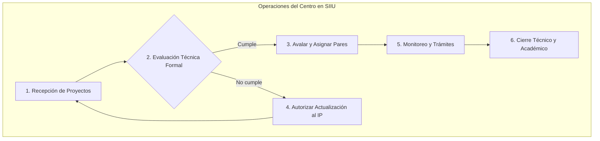

# Manual Operativo: Rol Centro de Investigación y Extensión

Los **Centros de Investigación y de Extensión** de las Facultades, Escuelas e Institutos de la Universidad de Antioquia son los nodos de articulación técnico-académica. Tienen la potestad de validar formalmente las propuestas, interactuar con los pares evaluadores, avalar iniciativas ante el CODI o Comités de Extensión, y aprobar los trámites administrativos de los proyectos adscritos.

---

## 1. Responsabilidades Centrales

1. **Evaluación Técnica Formal:** Comprobar si la propuesta cumple las condiciones habilitantes definidas en los Términos de Referencia de la convocatoria.
2. **Autorización de Ajustes:** Devolver al IP las propuestas que requieran subsanación formal, delimitando con precisión las secciones abiertas y fijando una fecha límite improrrogable.
3. **Gestión de Evaluadores Pares:** Seleccionar y asignar pares evaluadores idóneos (internos o externos) según el área de conocimiento y temática del proyecto.
4. **Aval Institucional:** Emitir el aval de la unidad académica para que el proyecto pueda continuar a las instancias centrales (Vicerrectoría / CODI).
5. **Aprobación de Solicitudes Administrativas:** Analizar las solicitudes de prórroga, cambios de rubro o modificaciones de participantes radicadas por los investigadores.
6. **Supervisión de Compromisos y Cierre:** Revisar los informes técnicos de avance y el informe final antes de ordenar el cierre formal del proyecto.

---

## 2. Rutas Rápidas en el Menú del SIIU

| Acción | Ruta en el Menú SIIU |
| :--- | :--- |
| **Realizar Evaluación Técnica de Proyectos** | `Convocatorias >> Proyectos en evaluación >> Filtros >> Acciones (...) >> Realizar evaluación técnica` |
| **Solicitar Actualización / Devolver a Investigador** | `Convocatorias >> Proyectos en evaluación >> Evaluación técnica >> Marcar "No cumple" >> Botón: Autorizar actualización` |
| **Asignar Evaluadores Pares al Proyecto** | `Convocatorias >> Aval de proyectos >> Seleccionar proyecto >> Botón: Asignar evaluador` |
| **Avalar Proyecto post-evaluación** | `Convocatorias >> Aval de proyectos >> Seleccionar proyecto >> Emitir Aval` |
| **Aprobar Solicitudes Administrativas** | `Trámites administrativos >> Flujo de procesos administrativos y novedades >> Consulta >> Acciones (...) >> Aprobar / Rechazar` |
| **Revisar Compromisos Académicos Entregados** | `Trámites administrativos >> Seguimiento proyectos >> Seleccionar proyecto >> Botón: Compromisos` |
| **Generar Cierre del Proyecto** | `Trámites administrativos >> Seguimiento proyectos >> Seleccionar proyecto >> Botón: Cierre de proyecto` |
| **Generar Constancia de Proyectos por Grupo** | `Constancias >> Proyectos por Grupo de Investigación` |
| **Consultar Historial Completo de Proyectos del Centro** | `Convocatorias >> Reportes >> Historial de Proyecto` *(o `Reportes >> Historial de Proyecto`)* |

---

## 3. Procedimiento Clave: Devolución para Actualización

Cuando un proyecto no cumple con todas las condiciones formales en la revisión inicial del Centro:

1. Ingrese a la evaluación técnica y marque con **"No cumple"** la condición respectiva.
2. Presione **GUARDAR**. El sistema habilitará el botón **`Autorizar actualización`**.
3. En la ventana emergente:
   - Seleccione el tipo de evaluación.
   - Defina la **Fecha y Hora límite** para que el investigador corrija.
   - Marque con exactitud las **secciones habilitadas** (ej. Presupuesto, Metodología, Documentos soporte). Las secciones no seleccionadas permanecerán bloqueadas para el investigador.
   - Redacte en el campo **Cambios solicitados** las instrucciones claras (máximo 400 caracteres).
4. Presione **AUTORIZAR ACTUALIZACIÓN** y confirme el diálogo de seguridad.
5. El proyecto pasará a estado **Pendiente de actualización** y se notificará automáticamente al investigador por correo institucional.

---

## 🔗 Guías Detalladas de Interés
- [Evaluacion y Aval](../02_PROCESOS_CLAVE/Evaluacion_y_Aval.md): Protocolo completo de evaluación técnica, devolución y asignación de pares.
- [Modificaciones y Tramites](../02_PROCESOS_CLAVE/Modificaciones_y_Tramites.md#aprobacion-en-centro): Cómo gestionar y aprobar solicitudes administrativas en el Centro.
- [Cierre y Liquidacion](../02_PROCESOS_CLAVE/Cierre_y_Liquidacion.md): Protocolo de verificación de compromisos y trámite de cierre.
- [CheatSheet Centro](../03_GUIAS_RAPIDAS_CHEAT_SHEETS/CheatSheet_Centro.md): Ficha de referencia rápida y criterios de control.
