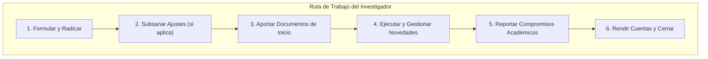

# Manual Operativo: Rol Investigador Principal y Tutor

El **Investigador Principal (IP)** o **Coordinador de Proyecto (CP)** es el líder académico y técnico del proyecto ante la Universidad de Antioquia y ante los entes financiadores. En el **SIIU**, el IP administra sus iniciativas desde la postulación hasta el cierre final.

---

## 1. Responsabilidades Centrales

1. **Matrícula y Calidad de la Información:** Registrar adecuadamente la metodología, el cronograma, el presupuesto detallado y la caracterización complementaria (ODS, Misión de Sabios, G8).
2. **Atención a Requerimientos del Centro:** Si la propuesta es devuelta para ajustes en la etapa técnica formal, responder dentro del plazo límite asignado.
3. **Gestión de Trámites Administrativos:** Solicitar oportunamente prórrogas de tiempo o traslados presupuestales antes de que expiren los plazos o se agoten los recursos.
4. **Tutoría de Jóvenes Investigadores:** Matricular el cupo adjudicado y registrar la hoja de vida del estudiante seleccionado verificando las condiciones bancarias.
5. **Cumplimiento de Compromisos:** Cargar en los tiempos estipulados los informes de avance, informes finales y evidencias de productos de investigación.

---

## 2. Rutas Rápidas en el Menú del SIIU

| Acción | Ruta en el Menú SIIU |
| :--- | :--- |
| **Inscribir nuevo proyecto en convocatoria** | `Convocatorias >> Inscripción >> Proyectos en convocatoria` |
| **Inscribir proyecto con financiación externa** | `Convocatorias >> Inscripción >> Proyectos inscritos` |
| **Matricular primer proyecto (investigador nuevo)** | `Convocatorias >> Inscripción >> Primer proyecto` |
| **Consultar o ajustar propuesta devuelta** | `Convocatorias >> Proyectos en proceso >> Estado: Pendiente Actualización >> Acciones (...) >> Editar` |
| **Matricular cupo de Joven Investigador** | `Convocatorias >> Inscripción >> Cupos joven investigador` |
| **Registrar hoja de vida de estudiante JI** | `Trámites administrativos >> Seguimiento mis proyectos >> Seleccionar cupo >> Botón: Hoja de vida JI` |
| **Radicar solicitud de prórroga o cambio de rubro** | `Trámites administrativos >> Nueva solicitud o Novedad >> Solicitud` *(para proyectos internos)* |
| **Radicar novedad con aval externo** | `Trámites administrativos >> Nueva solicitud o Novedad >> Novedad` *(para proyectos externos)* |
| **Cargar o entregar compromisos académicos** | `Trámites administrativos >> Seguimiento mis proyectos >> Botón: Compromisos` |
| **Descargar constancia personal de participación** | `Constancias >> Participación en proyectos >> Seleccionar cédula >> Ver constancia` |

---

## 3. Puntos de Control Críticos para el Investigador

> **ADVERTENCIA:** ALERTA DE ARCHIVOS ADJUNTOS
> - **Nombre del archivo:** Máximo 30 caracteres, sin tildes, sin eñes (`ñ`), sin caracteres especiales (`#`, `$`, `%`, `&`, `/`) y sin espacios excesivos.
> - **Formato:** Exclusivamente **PDF**.
> - **Error común:** Nombrar archivos largos como *"INFORME_FINAL_PROYECTO_DE_INVESTIGACION_2024_APROBADO_VERSION_FINAL.pdf"*. El sistema truncará el archivo y generará error de guardado. Usa: *"InformeFinal_2024.pdf"*.

> **PRECAUCIÓN:** JÓVENES INVESTIGADORES: CUENTAS BANCARIAS
> - **Cuentas NO permitidas:** Nequi, Daviplata, Ahorro a la Mano, Bancolombia Agroseguro.
> - **Cuentas permitidas:** Cuenta de ahorros tradicional a nombre del estudiante.
> - **Nota:** La Universidad **no emite cartas para apertura de cuentas bancarias** para Jóvenes Investigadores porque no se trata de un contrato laboral, sino de un estímulo económico.

> **NOTA:** CAMBIO DE RUBRO PRESUPUESTAL
> - No intentes trasladar presupuesto desde un rubro cuyo saldo actual sea \$0.
> - El proyecto debe encontrarse en estado **En ejecución**.

---

## 🔗 Guías Detalladas de Interés
- [Matricula Proyectos](../02_PROCESOS_CLAVE/Matricula_Proyectos.md): Paso a paso de inscripción en convocatorias y proyectos inscritos.
- [Evaluacion y Aval](../02_PROCESOS_CLAVE/Evaluacion_y_Aval.md#subsanacion-y-ajustes-de-proyectos-devueltos): Cómo responder al Centro si devuelven tu proyecto.
- [Programa Joven Investigador](../02_PROCESOS_CLAVE/Programa_Joven_Investigador.md): Guía completa de cupos, hojas de vida y prórrogas de JI.
- [Modificaciones y Tramites](../02_PROCESOS_CLAVE/Modificaciones_y_Tramites.md): Cómo tramitar prórrogas y cambios de presupuesto.
- [CheatSheet Investigador](../03_GUIAS_RAPIDAS_CHEAT_SHEETS/CheatSheet_Investigador.md): Ficha de referencia rápida y rutas express.
