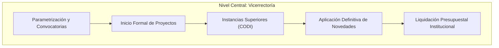
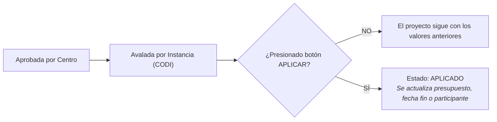

---
title: Manual Operativo - Rol Vicerrectoría de Investigación
description: Guía de parametrización, configuración de convocatorias, flujos de trámites, inicio formal y liquidación institucional para la Vicerrectoría de Investigación
tags:
  - roles
  - vicerrectoria
  - codi
  - administracion
  - siiu
---

# Manual Operativo: Rol Vicerrectoría de Investigación

La **Vicerrectoría de Investigación** (junto con la **Vicerrectoría de Extensión**) ejerce la administración global del **SIIU**, define las políticas operativas, parametriza convocatorias, avala las solicitudes que requieren decisión de instancias superiores (CODI) y formaliza tanto el inicio como la liquidación presupuestal de los proyectos.

---

## 1. Responsabilidades Centrales

1. **Configuración de Convocatorias:** Parametrizar cronogramas, términos de referencia, montos máximos, rubros permitidos, formularios dinámicos y criterios de evaluación.
2. **Configuración de Flujos de Trámites:** Establecer las rutas de aprobación por tipo de trámite (Centro -> Instancia -> Vicerrectoría) y los permisos asociados.
3. **Formalización del Inicio de Proyectos:** Verificar la radicación de contratos, pólizas de garantía (cumplimiento, salarios, calidad), convenios y la asignación del Centro de Costos financiero antes de emitir el Acta de Inicio Formal.
4. **Aval de Instancias Superiores:** Tramitar las solicitudes que requieren aprobación del Comité para el Desarrollo de la Investigación (CODI) o Comités Centrales.
5. **Aplicación en Firme de Solicitudes:** Una vez avaladas por las instancias, ejecutar el botón **APLICAR** para que los cambios presupuestales o de tiempo impacten las tablas maestras del sistema.
6. **Liquidación y Cierre Financiero:** Emitir el acta de liquidación definitiva tras comprobar la legalización del 100% de los recursos ante la División Financiera.

---

## 2. Rutas Rápidas en el Menú del SIIU

| Acción | Ruta en el Menú SIIU |
| :--- | :--- |
| **Configurar una Nueva Convocatoria** | `Configuración >> Convocatorias >> Gestión de convocatorias >> Nueva convocatoria` |
| **Configurar Flujos de Trámites Administrativos** | `Configuración >> Flujo de trámites >> Configuración trámites` |
| **Inicio Formal de Proyectos** | `Trámites administrativos >> Inicio formal de proyectos >> Seleccionar proyecto >> Registrar pólizas/contrato >> Generar Acta` |
| **Avalar y Aplicar Solicitudes Administrativas** | `Trámites administrativos >> Flujo de procesos administrativos y novedades >> Consulta >> Instancia: Vicerrectoría >> Botón: Avalar / Aplicar` |
| **Cambiar Responsable del Proyecto** | `Trámites administrativos >> Cambiar responsable del proyecto >> Buscar proyecto >> Seleccionar nuevo docente` |
| **Aprobar Cupos de Joven Investigador** | `Convocatorias >> Gestión cupos >> Aprobación cupos JI` |
| **Cierre y Liquidación Institucional** | `Trámites administrativos >> Seguimiento proyectos >> Cierre de proyecto >> Liquidación final` |
| **Generar Reportes Analíticos Consolidados** | `Convocatorias >> Reportes >> Información básica de proyectos` |

---

## 3. El Paso Clave: Avalar vs Aplicar Solicitudes

En el SIIU, una solicitud puede estar **Aprobada** o **Avalada**, pero **NO se hace efectiva** hasta que la Vicerrectoría presiona **APLICAR**:

> [!IMPORTANT] REGLA DE APLICACIÓN
> Mientras una solicitud no esté en estado **APLICADO**, el presupuesto del proyecto no se moverá, la fecha de terminación no se extenderá y el nuevo participante no aparecerá en las constancias.

---

## 🔗 Guías Detalladas de Interés
- [[Inicio_Formal]]: Protocolo de inicio, validación de pólizas y emisión de acta.
- [[Modificaciones_y_Tramites#aplicacion-en-vicerrectoria]]: Aval y aplicación de trámites administrativos.
- [[Cierre_y_Liquidacion#liquidacion-en-vicerrectoria]]: Liquidación institucional.
- [[Catalogo_Normativo_31_Docs]]: Relación completa con los 31 documentos fuente.
