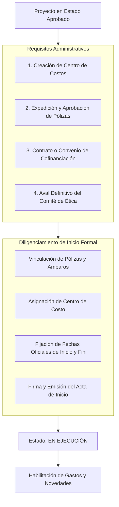

---
title: Proceso Clave - Inicio Formal de Proyectos en SIIU
description: Requisitos contractuales, pólizas, asignación de centros de costo y generación del Acta de Inicio Formal en el Sistema SIIU
tags:
  - procesos
  - inicio-formal
  - acta-de-inicio
  - polizas
  - centro-de-costos
  - siiu
---

# Proceso Clave: Inicio Formal de Proyectos

La aprobación de un proyecto en una convocatoria no autoriza de manera automática el gasto de los recursos ni el reconocimiento oficial de tiempos. Para ello se requiere el **Inicio Formal**, un hito administrativo y legal que marca el paso del estado **Aprobado** al estado **En ejecución**.

---

## 1. Requisitos Previos al Inicio Formal

Antes de tramitar el acta de inicio formal en el SIIU, se deben consolidar los siguientes instrumentos:

1. **Centro de Costos (Centro Administrativo / Financiero):** Código contable asignado por el Departamento de Presupuesto para la ejecución de los recursos en el sistema financiero institucional.
2. **Pólizas de Garantía (cuando aplique por cuantía o convenio externo):**
   - Amparo de Buen Manejo y Correcta Inversión del Anticipo.
   - Amparo de Cumplimiento del Contrato.
   - Amparo de Salarios, Prestaciones Sociales e Indemnizaciones.
   - Amparo de Calidad de los Bienes o Servicios.
3. **Contratos o Convenios Interinstitucionales:** En proyectos con financiación externa o convenios marco entre universidades o empresas.
4. **Aval Ético Definitivo:** Certificación expedida por el Comité de Ética de la Investigación (humana o animal) correspondiente.

---

## 2. Diligenciamiento del Inicio Formal en el SIIU (Rol Vicerrectoría)

- **Ruta SIIU:** `Trámites administrativos >> Inicio formal de proyectos`
- 📘 Guía oficial: [VI-GU-15](../../archivo_maestro/VI-GU-15.md)

### Pasos Operativos:
1. **Búsqueda del Proyecto:** Localizar el proyecto en estado **Aprobado**.
2. **Pestaña Pólizas y Contratos:**
   - Registrar la aseguradora, número de póliza, fecha de expedición, fecha de vigencia y valores asegurados por cada amparo.
   - Adjuntar el PDF de la póliza aprobada por la Dirección Jurídica o División de Asesoría Jurídica.
3. **Pestaña Centro de Costos:**
   - Vincular el código financiero alfanumérico generado en el sistema central de presupuesto.
4. **Pestaña Fechas Oficiales:**
   - **Fecha de Inicio Formal:** Día oficial a partir del cual rige la vigencia legal del proyecto.
   - **Fecha de Terminación Oficial:** Calculada automáticamente con base en los meses de duración aprobados.
5. **Generación del Acta de Inicio:**
   - El sistema compila la información y genera el documento formal del **Acta de Inicio**.
   - Se legalizan las firmas del Investigador Principal, el Jefe de Centro y el Delegado de la Vicerrectoría.
6. Al presionar **CONFIRMAR INICIO FORMAL**, el proyecto adquiere formalmente el estado **En ejecución**.

---

## 3. ¿Qué ocurre si se vence el plazo sin iniciar?

> [!CAUTION] VENCIMIENTO DEL PLAZO DE INICIO
> Si los trámites de pólizas o contratos toman más tiempo del reglamentario, el proyecto puede caer en estado **No iniciado** o ser **Cancelado**.  
> Para evitar esto, el Investigador Principal debe solicitar oportunamente una **Prórroga de Inicio** mediante el menú de trámites administrativos mientras el proyecto aún figure en estado **Aprobado**.  
> Consulta: [[Modificaciones_y_Tramites#prorroga-de-proyecto]].

---

## 🔗 Próximo Paso en el Flujo
Con el proyecto **En ejecución**, se habilitan las compras, contrataciones, solicitudes de cambio de presupuesto y adición de tiempo:
Consulta **[[Modificaciones_y_Tramites]]** y **[[Gestion_Compromisos]]**.
