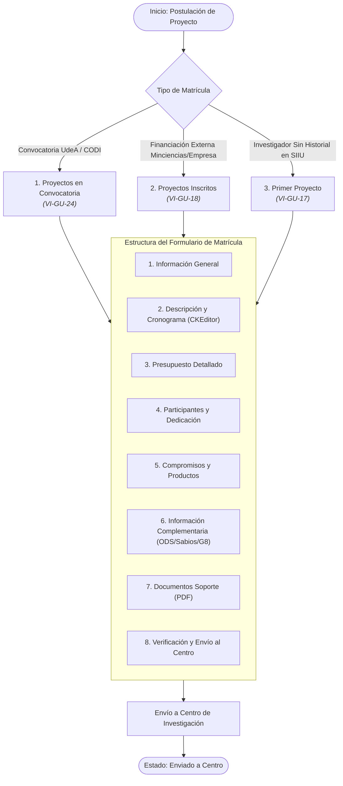
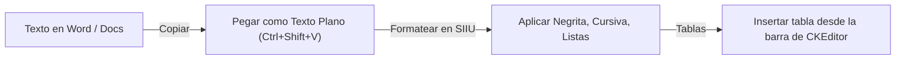

# Proceso Clave: Matrícula e Inscripción de Proyectos

El proceso de matrícula en el **SIIU** es la puerta de entrada para todas las iniciativas científicas, tecnológicas, artísticas y de extensión en la Universidad de Antioquia.

---

## 1. Modalidades de Matrícula

### Convocatoria Interna
- **Aplica para:** Convocatorias programáticas, de menor cuantía, apoyo a grupos o fondos especiales financiados con recursos de la Universidad (CODI, BUP).
- **Ruta SIIU:** `Convocatorias >> Inscripción >> Proyectos en convocatoria`
- **Requisito previo:** La convocatoria debe encontrarse en estado **Vigente** y dentro de las fechas fijadas en el cronograma.
- 📘 Guía oficial: [VI-GU-24](../../archivo_maestro/VI-GU-24.md)

### Proyectos Inscritos (Financiación Externa)
- **Aplica para:** Proyectos aprobados por entidades externas (Ministerio de Ciencia, Tecnología e Innovación - Minciencias, Sistema General de Regalías - SGR, agencias internacionales, contratos de I+D con empresas) que requieren administración y aval de la UdeA.
- **Ruta SIIU:** `Convocatorias >> Inscripción >> Proyectos inscritos`
- **Particularidad:** Requiere adjuntar la carta formal de asignación de recursos o contrato del ente financiador externo.
- 📘 Guía oficial: [VI-GU-18](../../archivo_maestro/VI-GU-18.md)

### Primer Proyecto
- **Aplica para:** Profesores o investigadores que postulan su primera propuesta en el sistema SIIU y no cuentan con registro histórico previo.
- **Ruta SIIU:** `Convocatorias >> Inscripción >> Primer proyecto`
- 📘 Guía oficial: [VI-GU-17](../../archivo_maestro/VI-GU-17.md)

---

## 2. Las 8 Pestañas del Formulario de Matrícula

### Pestaña 1: Información General
- Título del proyecto (claro y conciso).
- Tipo de investigación (Básica, Aplicada, Desarrollo Tecnológico).
- Centro administrativo que gestionará la propuesta.
- Grupo de investigación principal que avala la postulación (y grupos secundarios si es intergrupal).
- Duración estimada en meses.

### Pestaña 2: Descripción y Cronograma
- Resumen ejecutivo, planteamiento del problema, justificación, marco teórico, objetivos generales y específicos, metodología y resultados esperados.
- Uso del editor de texto enriquecido: consultar [#editor-ckeditor](#editor-ckeditor).
- Cronograma de actividades distribuido por bimestres o semestres.

### Pestaña 3: Presupuesto Detallado
- Desglose por rubros permitidos en la convocatoria (Personal, Materiales e insumos, Equipos, Salidas de campo, Servicios técnicos, Publicaciones, etc.).
- Discriminación de fuentes:
  - **Recursos Frescos / Efectivo:** Dinero líquido aportado por la convocatoria o financiador.
  - **Recursos en Especie / Contrapartida:** Horas de dedicación docente, uso de laboratorios o equipos institucionales.

### Pestaña 4: Participantes y Dedicación
- Investigador Principal (IP) / Coordinador.
- Coinvestigadores (docentes de planta, ocasionales, de cátedra o externos).
- Estudiantes de pregrado o posgrado y personal técnico.
- **Dato obligatorio:** Dedicación en horas semanales por participante.

### Pestaña 5: Compromisos y Productos
- Productos académicos comprometidos según la tipología Minciencias:
  - Generación de Nuevo Conocimiento (Artículos Q1-Q4, libros, capítulos).
  - Desarrollo Tecnológico e Innovación (Patentes, software registrado, prototipos).
  - Apropiación Social del Conocimiento (Talleres, eventos, cartillas).
  - Formación de Talento Humano (Dirección de tesis de maestría o doctorado, trabajos de grado).
- Fechas estimadas de entrega para cada producto.

### Pestaña 6: Información Complementaria
Obligatoria según las directrices institucionales de planeación:
- **Objetivos de Desarrollo Sostenible (ODS):** Seleccionar los ODS a los que tributa la investigación y las metas específicas.
- **Focos de la Misión de Sabios:** Clasificar la propuesta en uno de los 8 focos estratégicos del país.
- **Agendas Regionales G8:** Identificar áreas temáticas de impacto en el departamento.
- **Caracterización Socioeconómica:** Población beneficiaria directa e indirecta.
- 📘 Guía oficial: [VI-GU-16](../../archivo_maestro/VI-GU-16.md)

### Pestaña 7: Documentos Soporte
- Carta de aval del grupo de investigación firmada por el coordinador.
- Aval del Comité de Ética o Bioética (si aplica para experimentación animal o con humanos).
- Términos de referencia firmados, cotizaciones o cartas de intención de cofinanciadores.
- **Regla:** Archivos exclusivamente en formato PDF, tamaño controlado y nombres cortos (máx. 30 caracteres, sin tildes ni símbolos).

### Pestaña 8: Enviar al Centro
- Verificación automática de campos obligatorios.
- Botón **"Enviar a Centro"**: genera el código de proyecto provisional del SIIU (ej. `2024-XXXXX`) y envía la propuesta a la bandeja del Centro de Investigación.

---

## 3. Editor de Texto (CKEditor) en SIIU

El editor integrado permite dar formato a la formulación metodológica. Para evitar errores de guardado o problemas de renderizado:

> **CONSEJO:** REGLAS PARA EL CKEDITOR ([VI-GU-25](../../archivo_maestro/VI-GU-25.md))
> 1. **No copiar directamente estilos complejos de Word:** Los metadatos ocultos de MS Word (`mso-*`) pueden corromper el campo HTML y bloquear el guardado. Pega el texto plano y da formato en el SIIU.
> 2. **Tablas:** Usa el botón de tabla propio del editor, define bordes sencillos y evita combinar celdas complejas.
> 3. **Ecuaciones y fórmulas:** Insértalas como texto matemático plano o imágenes debidamente referenciadas.
> 4. **Guardado frecuente:** Presiona el botón de guardar periódicamente para no perder avances por expiración de sesión.

---

## 🔗 Próximo Paso en el Flujo
Una vez enviado el proyecto, el Centro de Investigación realizará la revisión habilitante:
Consulta **[Evaluacion y Aval](../02_PROCESOS_CLAVE/Evaluacion_y_Aval.md)**.
