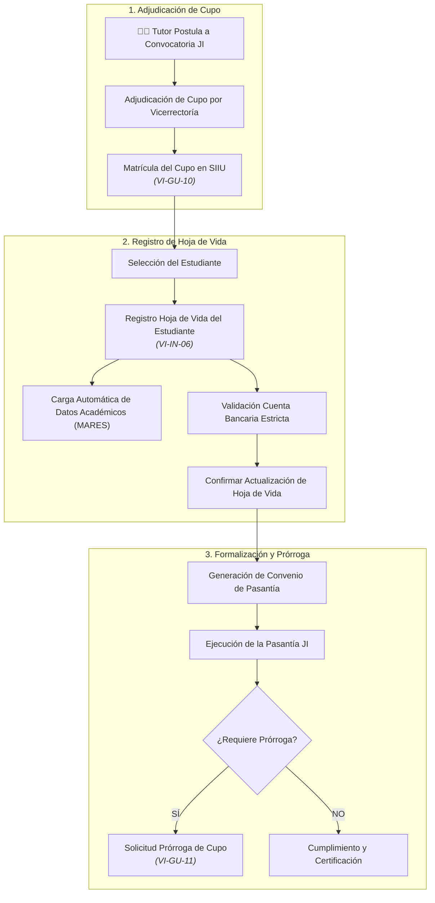

# Proceso Clave: Programa Joven Investigador

El **Programa Joven Investigador (JI)** de la Universidad de Antioquia es una estrategia de fomento a la vocación científica mediante pasantías remuneradas con estímulo económico para estudiantes destacados de pregrado y recién graduados.

---

## 1. Matrícula de Cupos de Joven Investigador (Rol Tutor)

Una vez publicados los resultados de la convocatoria institucional de Jóvenes Investigadores:

- **Ruta SIIU:** `Convocatorias >> Inscripción >> Cupos joven investigador`
- **Pasos:**
  1. Identificar la convocatoria específica del Programa Joven Investigador.
  2. Diligenciar la información del plan de trabajo asociado al proyecto marco.
  3. Indicar el objetivo de formación, metodología de acompañamiento del tutor y productos esperados (informe final y artículo/ponencia).
  4. Radicar la matrícula del cupo para validación de la Vicerrectoría.
- 📘 Guía oficial: [VI-GU-10](../../archivo_maestro/VI-GU-10.md)

---

## 2. Registro de Estudiante / Hoja de Vida JI

Una vez asignado el cupo, el tutor debe vincular formalmente al estudiante seleccionado:

- **Ruta SIIU:** `Trámites administrativos >> Seguimiento mis proyectos >> Centro: TODOS >> Código de cupo >> Consultar >> Botón: Hoja de vida JI`
- 📘 Instructivo oficial: [VI-IN-06](../../archivo_maestro/VI-IN-06.md)

### Secciones de la Hoja de Vida:
1. **Datos Personales:** Al ingresar la cédula del estudiante, el SIIU se comunica con el sistema central **MARES** y precarga nombres, apellidos, lugar de nacimiento y fecha de nacimiento.
   - *Nota:* Si algún dato personal está errado, debe actualizarse primero en MARES en la oficina de Admisiones y Registro.
2. **Ubicación de Residencia:** Asignar Continente, País, Departamento y Municipio mediante la ventana emergente de ubicación.
3. **Información Académica:** Precargada desde MARES (carrera, semestre actual, fecha de inicio y finalización del semestre lectivo).
4. **Datos de Cuenta Bancaria:** Se deben ingresar los datos exactos para el giro mensual del estímulo económico:
   - Banco.
   - Número de cuenta.
   - Tipo de cuenta (Ahorros).

---

## Reglas Bancarias Inquebrantables para Jóvenes Investigadores

> **PRECAUCIÓN:** PROHIBICIÓN ESTRICTA DE BILLETERAS DIGITALES
> Por directriz de la División de Tesorería de la Universidad de Antioquia:
> - ❌ **NO se permiten:** Cuentas Nequi, Daviplata, Bancolombia Ahorro a la Mano ni cuentas de Agroseguro.
> - **SÍ se permiten:** Únicamente **cuentas de ahorros tradicionales** radicadas en entidades financieras legalmente vigiladas por la Superintendencia Financiera de Colombia.
> - **Titularidad:** La cuenta bancaria debe estar **exclusivamente a nombre del Joven Investigador** (no se aceptan cuentas de padres, cónyuges, tutores ni terceros).

> **IMPORTANTE:** NO SE EMITEN CARTAS LABORALES PARA APERTURA DE CUENTA
> La Universidad **NO expide cartas institucionales para apertura de cuenta bancaria** a Jóvenes Investigadores, dado que la pasantía **no constituye vínculo laboral**, sino un **estímulo económico de fomento a la formación**. El estudiante debe aperturar su cuenta personal mediante los mecanismos habituales para personas naturales.

---

## 3. Prórroga de Cupos del Programa Joven Investigador

Si por razones justificadas en el plan de investigación se requiere extender el tiempo de la pasantía dentro de los márgenes contemplados en la convocatoria:

- **Ruta SIIU:** `Trámites administrativos >> Nueva solicitud o Novedad >> Solicitud >> Prórroga cupos joven investigador`
- **Requisitos:**
  - El cupo debe encontrarse activo y en ejecución.
  - Presentar balance de actividades ejecutadas y justificación de los meses adicionales requeridos.
  - Aval del tutor del proyecto.
- 📘 Guía oficial: [VI-GU-11](../../archivo_maestro/VI-GU-11.md)
