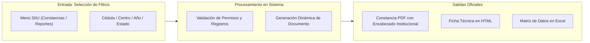

# Proceso Clave: Reportes y Certificaciones Oficiales

El **SIIU** genera documentos oficiales para acreditar la trayectoria académica y científica de profesores, investigadores y evaluadores, así como reportes de control directivo para centros y vicerrectorías.

---

## 1. Constancias Oficiales en PDF

### Constancias de Participación en Proyectos (Personas)
Acredita la participación formal de un docente, investigador, estudiante o técnico en proyectos de investigación o extensión avalados por la Universidad.
- **Ruta SIIU:** `Constancias >> Participación en proyectos`
- **Pasos:**
  1. Presione el botón **Seleccionar**.
  2. Ingrese el número de cédula del participante y presione **Buscar**.
  3. Marque con check el nombre de la persona encontrada y presione **Agregar**.
  4. *(Opcional)* Defina un rango de fechas de participación. Si lo deja vacío, el sistema traerá el **histórico completo** de todos los proyectos en que ha participado.
  5. Presione **Buscar**. El sistema listará los proyectos.
  6. Presione el botón **Ver constancia**: Se abrirá una ventana con el documento oficial en **PDF**, listo para descargar o imprimir.
- 📘 Instructivo oficial: [VI-IN-07](../../archivo_maestro/VI-IN-07.md)

### Constancias como Evaluador de Proyectos
Certifica la labor como par evaluador en convocatorias del CODI o de centros de investigación.
- **Ruta SIIU:** `Constancias >> Evaluador` *(o `Constancias >> Jurado`)*
- **Pasos:**
  1. Seleccione el tratamiento de cortesía (Profesor, Dra., Mg., etc.).
  2. Presione **Seleccionar**, busque la cédula del evaluador y márquelo con check.
  3. Indique el rango de fechas de evaluación y presione **Buscar**.
  4. Presione **Ver constancia** para descargar el certificado oficial en formato **PDF**.
- 📘 Instructivo oficial: [VI-IN-08](../../archivo_maestro/VI-IN-08.md)

### Constancias de Proyectos por Grupo de Investigación
Certifica el portafolio de proyectos gestionados por un grupo de investigación avalado ante la Universidad.
- **Ruta SIIU:** `Constancias >> Proyectos por Grupo de Investigación`
- **Pasos:**
  1. Seleccionar la Unidad Académica y el Centro de Investigación.
  2. Seleccionar el Grupo de Investigación en la lista desplegable.
  3. Filtrar por estado de los proyectos (*Todos*, *En ejecución*, *Finalizados*).
  4. Generar el reporte oficial en **PDF**.
- 📘 Instructivo oficial: [VI-IN-01](../../archivo_maestro/VI-IN-01.md)

---

## 2. Reportes Analíticos y de Gestión

### Reporte por Persona (Histórico Individual)
- **Ruta SIIU:** `Reportes >> Consulta por persona`
- **Alcance por rol:**
  - *Investigador:* Solo puede consultar su propia cédula.
  - *Centro y Vicerrectoría:* Pueden consultar cualquier persona registrada en el portal.
- **Información entregada:** Código del proyecto, título, grupo de investigación, rol asumido (IP, coinvestigador, asesor), horas de dedicación semanal, función específica, fechas de vinculación y retiro, y vínculo institucional.
- **Ficha Técnica HTML:** Al final de cada fila, haciendo clic en el icono de visualización, se despliega en una ventana emergente la ficha técnica completa del proyecto formulado originalmente.
- **Exportación:** Permite exportar el listado completo a **PDF**.
- 📘 Instructivo oficial: [VI-IN-11](../../archivo_maestro/VI-IN-11.md)

### Reporte Historial de Proyectos
- **Ruta SIIU:** `Reportes >> Historial de Proyecto` *(o `Convocatorias >> Reportes >> Información básica de proyectos >> Historial`)*
- **Filtros avanzados:** Código, palabras clave, tipo de proyecto, estado, centro administrativo, año/mes de finalización, convocatoria y proceso de selección.
- **Exportación:** Permite visualizar en pantalla o descargar la matriz completa en archivo **Excel**.
- 📘 Instructivos oficiales: [VI-IN-02](../../archivo_maestro/VI-IN-02.md) y [VI-IN-10](../../archivo_maestro/VI-IN-10.md)

### Reporte de Información Básica de Proyectos
El reporte más completo y exhaustivo del sistema SIIU:
- **Ruta SIIU:** `Convocatorias >> Reportes >> Información básica de proyectos`
- **Variables incluidas:** Año de apertura, convocatoria, línea temática/modalidad, centro administrativo, estado en el sub-proceso, nombre del proyecto, nombre del IP/CP, tipo de vinculación docente, unidad académica, grupo avalador, código SIIU, monto solicitado al financiador (recursos frescos y especie), monto total con cofinanciación y contrapartidas, calificaciones individuales de los evaluadores 1, 2 y 3, y puntaje promedio de evaluación.
- **Opciones avanzadas:**
  - Botón **Agregar Información**: Permite sumar columnas personalizadas a la cuadrícula de datos.
  - Botón **Exportar a Excel**: Descarga la base de datos completa.
  - Botón **Exportar a PDF**: Genera informe consolidado.
  - Botón **DESCARGAR PROYECTO**: Descarga en formato HTML la formulación completa del proyecto tal como fue matriculada.
- 📘 Instructivo oficial: [VI-IN-09](../../archivo_maestro/VI-IN-09.md)

---

## Regla de Navegadores y Ventanas Emergentes (Pop-ups)

> **ADVERTENCIA:** PERMISOS DE VENTANAS EMERGENTES (POP-UPS)
> Tanto las constancias oficiales en PDF como las fichas técnicas en HTML se abren en **ventanas emergentes nuevas**.  
> Si al presionar "Ver constancia" o "Visualizar" no se abre ninguna ventana:
> 1. Verifique la barra de direcciones en la parte superior derecha de su navegador (Chrome, Edge, Firefox).
> 2. Haga clic en el icono de ventana bloqueada.
> 3. Seleccione: **"Permitir siempre ventanas emergentes y redirecciones de https://ayudame2.udea.edu.co"**.
> 4. Presione **Listo** y vuelva a generar la consulta.
